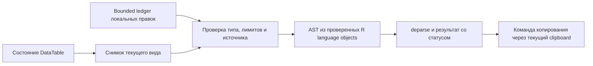

# Архитектура воспроизводимого кода DataTable

## Аудит существующих операций

DataTable уже владеет локальным состоянием строк и колонок: выбранными
столбцами и их порядком, фильтрами строк, фильтрами колонок, сортировкой,
диапазоном выделения и локальными изменениями. Рендер и scroll используют
виртуализированную видимую область. Поиск и положение курсора относятся к
взаимодействию с интерфейсом и сами по себе не меняют данные.

`selected_data()` возвращает выбранную область. Обычный Ctrl+C использует
существующую TSV-функцию clipboard. Источники DataTable обрабатываются через
текущий адаптер `table_source`; публичного API, который превращал бы их в
повторно исполнимый запрос или сохранял идентификатор источника, нет.

Проверка кода не обнаружила существовавшего генератора R-кода или журнала
операций DataTable. Локальные правки не имели отдельной bounded-истории для
экспорта. Новая реализация поэтому строит описание текущего вида из состояния
таблицы и отдельно хранит минимальный журнал незаменённых локальных правок.
Она не выдаёт это описание за историю действий пользователя.

## Изменения A4

- `R/reproducible-code.R` содержит внутреннюю типизированную модель,
  whitelist типов, проверки лимитов, построение AST и кодирование значений.
- `R/widget-datatable.R` добавляет методы DataTable, командные действия и
  bounded ledger правок с исходным номером строки.
- `R/commands.R` показывает действия воспроизводимого кода в существующем
  command palette и help.
- `docs/data.md`, `NEWS.md` и сгенерированные roxygen help темы описывают
  контракт и ограничения.

Новый пользовательский доступ — методы R6 DataTable
`$reproducible_code()`, `$copy_reproducible_code()` и `$commands()`;
отдельных package-level экспортов не добавлено. Clipboard использует
существующий механизм. Обычный Ctrl+C остаётся TSV, отдельная клавиша для
генерации кода не назначена.

## Поток данных

Копирование значений читает только выделенные строки и видимые колонки;
для `table_source` адаптер получает только выбранные строки. Код pipeline
ссылается на символический объект `data`. Путь, SQL, соединение и credentials
в модель или сгенерированный текст не попадают.

## Область ответственности

Генератор не создаёт другой фильтр, сортировщик, источник данных или
визуализацию. Он воспроизводит поддерживаемый текущий снимок локального
DataTable. Неподдерживаемые фильтры, классы и удалённые источники получают
явный статус `unsupported`; превышение ограничений — `limited`.
